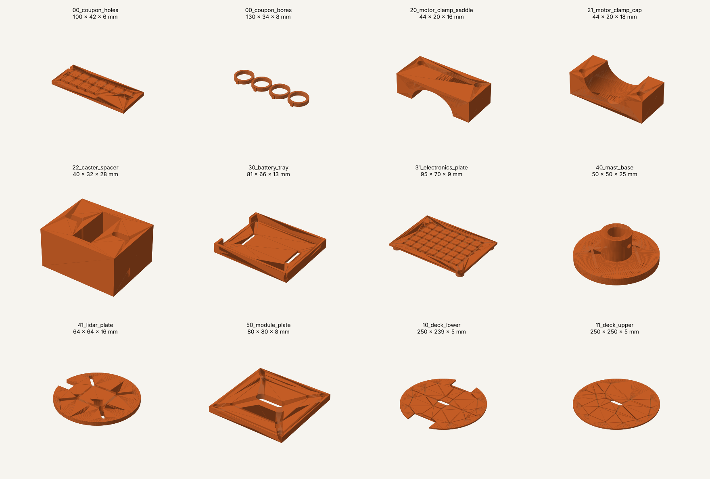

# handheld-robotics-v1

A 250 mm differential-drive robot base (ESP32-S3 + micro-ROS, Raspberry Pi 5,
RPLIDAR C1) with swappable top modules: a 2-finger parallel gripper and a
vacuum gripper. Build plan, BOM and phases live in the planning doc.

## Layout

| Path | What |
| --- | --- |
| `cad/params.py` | Every dimension in one place. Change, rebuild, done. |
| `cad/parts/` | CadQuery part generators (chassis, payload mounts, coupons) |
| `cad/build.py` | Builds all parts + `99_base_assembly.step` |
| `exports/step/` | STEP files for Onshape review |
| `exports/stl/` | STL files for the print service |
| `exports/dxf/` | Deck outlines for laser cutting |
| `exports/manifest.md` | Part list, quantities, sizes, PETG weight estimate |
| `firmware/` | ESP32-S3 micro-ROS firmware (Phase 0+) |
| `ros2_ws/` | ROS 2 packages (Phase 2+) |

## Build

```bash
python3.12 -m venv ~/venvs/cad && source ~/venvs/cad/bin/activate && pip install cadquery
./build.sh            # regenerate exports, commit, push
python cad/build.py coupon   # just the tolerance coupons
```

## Before the first print order

1. Print `00_coupon_holes` and `00_coupon_bores` only.
2. Holes coupon, left to right from the notch: row 1 = M3 clearance 3.0-3.7,
   row 2 = insert bores 3.7-4.4, row 3 = 4 mm D-shaft 3.9-4.3.
   Bores coupon: 1-4 ticks = 24.9 / 25.1 / 25.3 / 25.5.
3. Set `M3_CLEAR`, `M3_INSERT`, `MOTOR_FIT` in `params.py` to the sizes that fit.
4. Measure every value tagged MEASURE (wheel, motor, caster, battery).
5. `./build.sh`, then order the rest.

## Coordinate frame

x forward, y left, z up, origin on the floor under the wheel axle midpoint
(matches ROS REP-103 `base_footprint`).

## Print orientation (tell the print service)

| Part | Orientation | Why |
| --- | --- | --- |
| 20_motor_adapter (x2) | Nut-pocket face **up** | Pockets print without supports; 100% infill |
| 22_caster_spacer (x2) | Standing upright, either end down | 48.75 mm tall; 4 walls, 60% infill |
| 30_battery_tray | Flat base down | Countersinks face up |
| 31_electronics_plate | Grid face **down**, corner bosses up | No supports under the bosses |
| 40_mast_base | Disc down | Boss prints vertically, tube bore stays round |
| 41_lidar_plate | Plate **down**, boss up | Bore stays round |
| 50_module_plate | Flat, counterbores up | |
| Coupons | Flat | |

PETG, 0.2 mm layers, 3 walls, 40 % gyroid infill. Heat-set inserts go in after printing.


